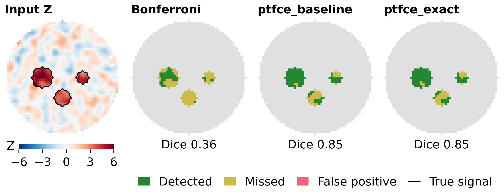
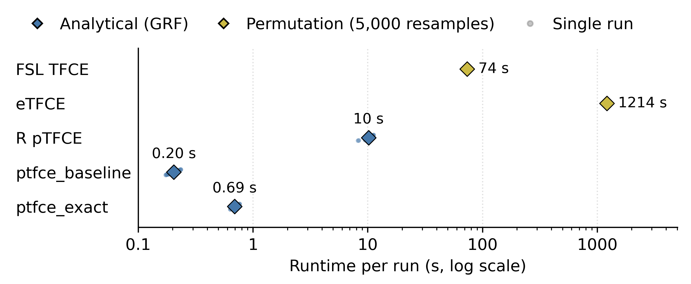

# pytfce

Fast probabilistic Threshold-Free Cluster Enhancement in Python: analytical p-values for neuroimaging maps, without permutations.

https://github.com/user-attachments/assets/c237f791-de9b-4d04-9f51-82abb3eb1e05

How pTFCE works, from p-values to the package (10 min, CC BY-SA 4.0; [download](https://github.com/Don-Yin/pytfce/releases/download/v0.1.2/pytfce-how-it-works.mp4)).

**Docs:** [Usage](https://github.com/Don-Yin/pytfce/blob/main/docs/usage.md) · [API reference](https://github.com/Don-Yin/pytfce/blob/main/docs/api.md) · [Variants](#variants) · [Validation](#validation) · [Paper](https://arxiv.org/abs/2603.11344)

## Quick start

```bash
pip install pytfce
```

```python
from pytfce import ptfce_baseline

result = ptfce_baseline(Z, mask)  # Z: 3-D Z-map, mask: boolean brain mask
result["p"], result["Z_enhanced"], result["fwer_z_thresh"]
```

Loading NIfTI and smoothness from residuals: [Usage](https://github.com/Don-Yin/pytfce/blob/main/docs/usage.md). Every parameter and result key: [API reference](https://github.com/Don-Yin/pytfce/blob/main/docs/api.md).

## Variants

| Variant | Method | Runtime (whole-brain VBM) | Best for |
|---------|--------|---------------:|----------|
| `ptfce_baseline` | pTFCE (Spisák et al. 2019): threshold grid + CCL | ~5 s | Standard use, small–medium volumes |
| `ptfce_exact` | eTFCE–GRF (union-find + GRF) | ~85 s | Large volumes, finer threshold grids |

Both variants use identical GRF p-values and aggregation. The baseline sweeps a threshold grid with connected-component labelling at each level; the hybrid uses a single union-find sweep, which eliminates discretisation error at higher constant computational cost.

## Validation

**Spatial detection.** Weak-signal phantom (64³ volume, 80 subjects, three embedded blobs), every method thresholded at FWER 0.05. Both pTFCE variants recover most of the signal that Bonferroni misses, with no false positives; Dice is computed over the whole volume, the panels show the slice through the blob centres:



**Runtime.** On whole-brain VBM (UK Biobank and IXI), the baseline takes about 5 s (75× faster than R pTFCE) and the hybrid about 85 s (4.6× faster); both are over 1000× faster than permutation TFCE ([arXiv:2603.11344](https://arxiv.org/abs/2603.11344)). On a 64³ phantom (pytfce 0.1.2, Apple M4 Max), `ptfce_baseline` takes 0.20 s and `ptfce_exact` 0.69 s, against 10 s for R pTFCE and 74 s for FSL TFCE with 5,000 permutations. Timings depend on the dataset, settings, and hardware.



## Citation

If you use `pytfce` in your research, please cite the software. Citation metadata is available in [CITATION.cff](https://github.com/Don-Yin/pytfce/blob/main/CITATION.cff) and GitHub's **Cite this repository** menu:

```bibtex
@software{pytfce,
  author = {Yin, Don and Chen, Hao},
  title  = {pytfce: {Fast} probabilistic {Threshold-Free Cluster Enhancement}
            in {Python}},
  year   = {2026},
  url    = {https://github.com/Don-Yin/pytfce}
}
```

For the companion methodology paper, please also cite the [arXiv preprint](https://arxiv.org/abs/2603.11344):

```bibtex
@misc{yin2026hybrid,
  author       = {Yin, Don and Chen, Hao and Miki, Takeshi and Yang, Enyu},
  title        = {Hybrid eTFCE--GRF: Exact Cluster-Size Retrieval with
                  Analytical $p$-Values for Voxel-Based Morphometry},
  year         = {2026},
  eprint       = {2603.11344},
  archiveprefix = {arXiv},
  url          = {https://arxiv.org/abs/2603.11344}
}
```

## License

MIT
