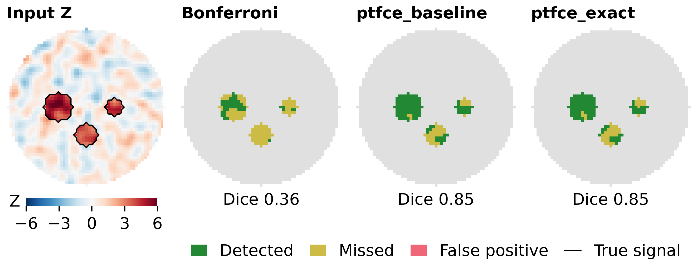

# pytfce

Fast probabilistic Threshold-Free Cluster Enhancement in Python: analytical p-values for neuroimaging maps, without permutations.

https://github.com/user-attachments/assets/c237f791-de9b-4d04-9f51-82abb3eb1e05

## Quick start

```bash
pip install pytfce
```

```python
from pytfce import ptfce_baseline

result = ptfce_baseline(Z, mask)  # Z: 3-D Z-map, mask: boolean brain mask
result["p"], result["Z_enhanced"], result["fwer_z_thresh"]
```

## Variants

| Variant | How it finds clusters | Default threshold grid |
|---------|-----------------------|-----------------------:|
| `ptfce_baseline` (R pTFCE method) | Labels connected components at each threshold | 100 |
| `ptfce_exact` (hybrid eTFCE–GRF) | Updates clusters in one union-find sweep | 500 |

Both use the same Gaussian random field probabilities and aggregation. Cluster sizes are exact at the sampled thresholds; both methods still approximate the integral over thresholds.

### Optional Numba backend

Python is the default. To compile the union-find loops:

```bash
pip install 'pytfce[accelerated]'
```

```python
from pytfce import ptfce_exact

result = ptfce_exact(Z, mask, uf_backend="numba")
```

## Validation

At a family-wise error rate of 0.05, both variants recover most of the three simulated signals that Bonferroni misses, with no false positives in this example. Dice measures overlap across the whole 64³ volume; the figure shows one slice through the signal centres (80 subjects).



| Read more | |
|---|---|
| [Explainer video](https://github.com/Don-Yin/pytfce/releases/download/v0.1.2/pytfce-how-it-works.mp4) | How pTFCE works, from p-values to the package (10 min; CC BY-SA 4.0) |
| [Usage](https://github.com/Don-Yin/pytfce/blob/main/docs/usage.md) | Read a NIfTI file, use residual smoothness, compare backend timings |
| [API reference](https://github.com/Don-Yin/pytfce/blob/main/docs/api.md) | Parameters, backend selection and result keys |
| [Cite the software](https://github.com/Don-Yin/pytfce/blob/main/CITATION.cff) | Versioned citation; also available from GitHub’s **Cite this repository** menu |
| [Companion paper](https://arxiv.org/abs/2603.11344) | Cite the preprint for the hybrid method |

## License

MIT
