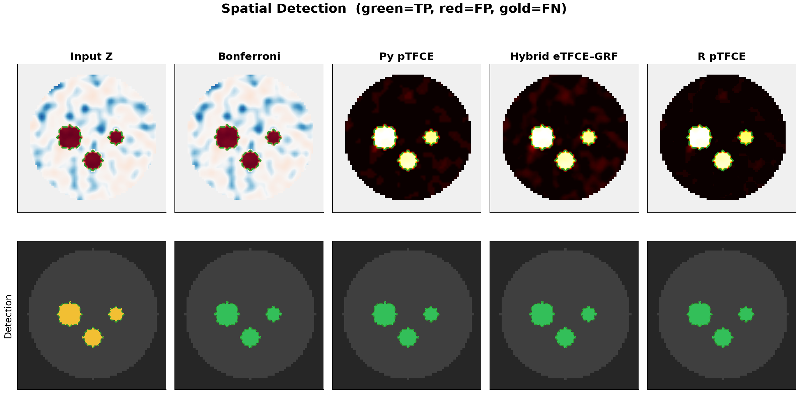
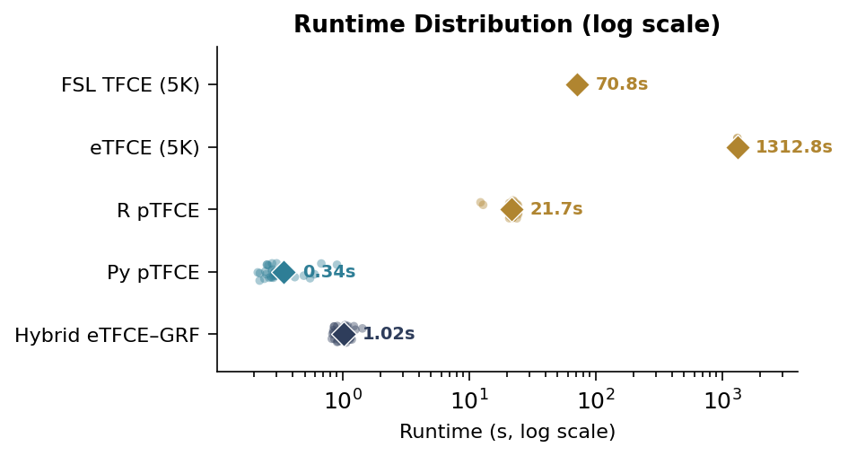

# pytfce

Fast probabilistic Threshold-Free Cluster Enhancement in Python.

## Overview

`pytfce` is a pure-Python package for probabilistic TFCE (pTFCE) that provides analytical inference on neuroimaging statistical maps without permutation testing. It implements a baseline pTFCE faithful to the original R package (Spisák et al. 2019) and a hybrid eTFCE–GRF that combines union-find cluster retrieval with analytical GRF p-values. On whole-brain VBM, the baseline runs in about 5 s, 75× faster than R pTFCE ([arXiv:2603.11344](https://arxiv.org/abs/2603.11344)); see [Validation](#validation).

## Installation

```bash
pip install pytfce

# development install
git clone https://github.com/Don-Yin/pytfce.git
cd pytfce
pip install -e .
```

**Dependencies:** NumPy, SciPy, connected-components-3d (installed automatically).

## Quick start

The NIfTI example below requires **NiBabel** (`pip install nibabel`). It is an optional I/O dependency; the core array-based API does not require it.

```python
import nibabel as nib
from pytfce import ptfce_baseline, ptfce_exact

img = nib.load("zstat1.nii.gz")
Z = img.get_fdata()
mask = Z != 0  # or load a proper brain mask

# --- baseline pTFCE (fast, matches R pTFCE) ---
result = ptfce_baseline(Z, mask)

# --- hybrid eTFCE–GRF (exact cluster retrieval) ---
result = ptfce_exact(Z, mask)

# result keys:
#   result["p"]           — enhanced p-values (3-D array)
#   result["logp"]          — −ln(p), natural log; use logp / ln(10) for −log10(p)
#   result["Z_enhanced"]    — enhanced Z-scores
#   result["fwer_z_thresh"] — GRF FWER Z-threshold for the enhanced map
#   result["smoothness"]    — estimated smoothness dict
#   result["diagnostics"]   — timings and run settings
```

## Variants

| Variant | Method | Runtime (whole-brain VBM) | Best for |
|---------|--------|---------------:|----------|
| `ptfce_baseline` | pTFCE (threshold grid + CCL) | ~5 s | Standard use, small–medium volumes |
| `ptfce_exact` | eTFCE–GRF (union-find + GRF) | ~85 s | Large volumes, finer threshold grids |

Both variants use identical GRF p-values and aggregation. The baseline sweeps a threshold grid with connected-component labelling at each level; the hybrid uses a single union-find sweep, which eliminates discretisation error at higher constant computational cost.

## Validation

**Spatial detection.** Phantom study (64³ volume, 80 subjects, 3 embedded blobs). All pTFCE variants achieve Dice = 1.0:



**Runtime.** On whole-brain VBM (UK Biobank and IXI), the baseline takes about 5 s (75× faster than R pTFCE) and the hybrid about 85 s (4.6× faster); both are over 1000× faster than permutation TFCE ([arXiv:2603.11344](https://arxiv.org/abs/2603.11344)). On the emulated phantom below, the baseline takes 0.34 s against 21.7 s for R pTFCE. Timings depend on the dataset, settings, and hardware.



## API reference

| Function | Description |
|----------|-------------|
| `ptfce_baseline(Z, mask, ...)` | Baseline pTFCE with LUT-accelerated GRF p-values |
| `ptfce_exact(Z, mask, ...)` | Hybrid eTFCE–GRF via union-find + analytical GRF |
| `estimate_smoothness(Z, mask)` | Estimate image smoothness (FWHM) from a Z-score map |
| `estimate_smoothness_from_residuals(Y, X, mask)` | Estimate smoothness from GLM residuals |
| `fwer_z_threshold(n_resels, alpha)` | GRF Euler-characteristic FWER Z-threshold |
| `pvox_clust(V, Rd, c, h)` | P(Z ≥ h \| cluster_size = c) via GRF Bayes' rule |
| `aggregate_logpvals_vec(s, delta)` | Vectorised Q-function for log-probability aggregation |

## Citation

If you use `pytfce` in your research, please cite the software. Citation metadata is available in [CITATION.cff](https://github.com/Don-Yin/pytfce/blob/main/CITATION.cff) and GitHub's **Cite this repository** menu:

```bibtex
@software{pytfce,
  author = {Yin, Don and Chen, Hao},
  title  = {pytfce: {Fast} probabilistic {Threshold-Free Cluster Enhancement}
            in {Python}},
  year   = {2026},
  url    = {https://github.com/Don-Yin/pytfce}
}
```

For the companion methodology paper, please also cite the [arXiv preprint](https://arxiv.org/abs/2603.11344):

```bibtex
@misc{yin2026hybrid,
  author       = {Yin, Don and Chen, Hao and Miki, Takeshi and Yang, Enyu},
  title        = {Hybrid eTFCE--GRF: Exact Cluster-Size Retrieval with
                  Analytical $p$-Values for Voxel-Based Morphometry},
  year         = {2026},
  eprint       = {2603.11344},
  archiveprefix = {arXiv},
  url          = {https://arxiv.org/abs/2603.11344}
}
```

## License

MIT
